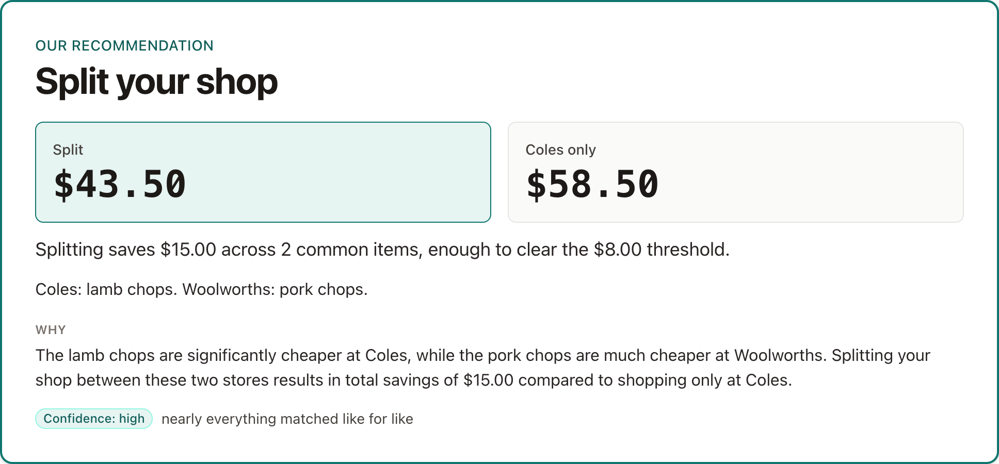
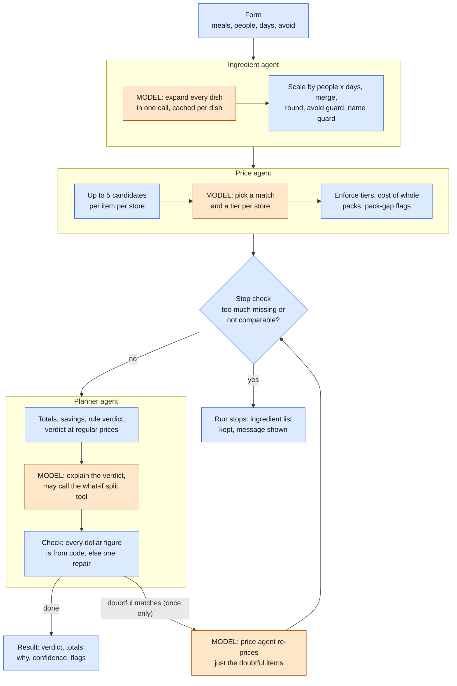
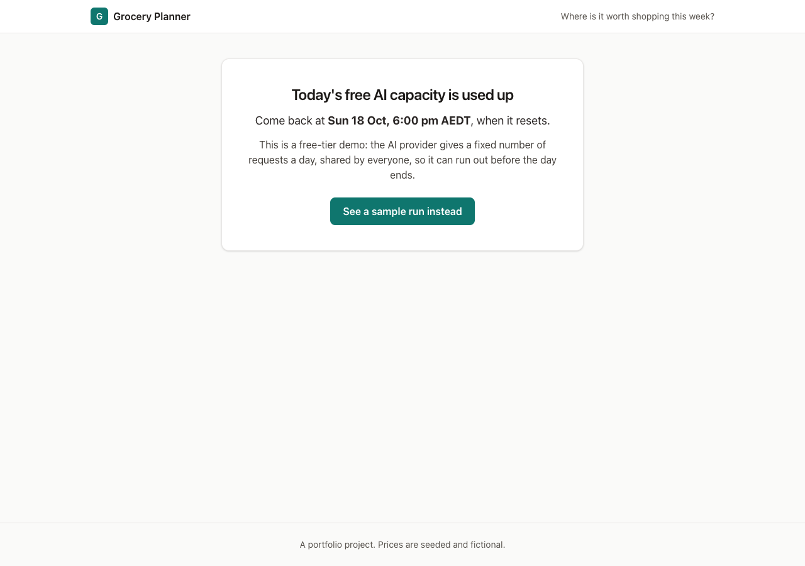

# Grocery Planner

Describe the meals you plan to cook; three agents build the shopping list, price it at two supermarkets and say whether it is worth splitting the shop. Code does the arithmetic; the models decide and explain.

**Live demo: https://grocery-planner-99862655427.australia-southeast1.run.app** · [Sample run](https://grocery-planner-99862655427.australia-southeast1.run.app/runs/f95caaf0-a6fc-4587-9395-7422e48bf67d)

It is a free-tier demo with seeded, fictional prices. On the form, **Try an example** has four presets that fill it in: a close call, one store clearly cheaper, a split, and a verdict that depends on a special ending. Usually about 10 seconds; slower when the free model is busy (p90 31 s). The first visit after a quiet spell takes a few seconds longer because the service scales to zero.



| 3 | 10 s | $0.003 | 39 of 39 |
| :---: | :---: | :---: | :---: |
| model requests per run (median) | end-to-end time (median; p90 31 s) | would-be paid-tier cost per run (median) | eval cases passing in CI |

From 20 completed runs of the last 7 days (my own test runs, not users) and the CI evals run of 2026-10-18. Sources, queries and caveats: [docs/NUMBERS.md](docs/NUMBERS.md).

**Contents:** [How it works](#how-it-works) · [Design decisions](#design-decisions-and-trade-offs) · [Evals](#evals) · [Guardrails](#guardrails-and-safety) · [Observability](#observability) · [Lessons learned](#lessons-learned) · [Limitations](#limitations-and-what-id-change-at-scale) · [Run it](#run-it-locally-and-deploy) · [Docs](docs/README.md)

## How it works



Orange boxes are model calls; blue boxes are plain code. A normal run makes 2 to 4 model requests.

The agents do the parts that need judgment: what a dish probably contains, which supermarket product matches an ingredient, and how to explain a verdict in plain words. Everything that must be exact is code: scaling quantities, merging lines, whole-pack costs, totals, the decision rule, the confidence level and the dollar figures. The planner follows a verdict that code computed and may override it for one reason only, doubtful matches. Every dollar amount in its text has to equal a number code produced or a tool returned, or the answer goes back for one repair. A run is a fixed sequence with one loop-back, so its cost and behaviour are predictable.

## Design decisions and trade-offs

- **Batching, over one call per item.** The ingredient agent expands all dishes in one call and the price agent prices all items in one call, because the binding limit is the free tier's requests per day (500 a day, as shown in AI Studio for this project's models and checked on 2026-10-14; Google can change it), not tokens. A run costs 2 to 4 requests, so the daily budget covers about 99 runs at the median.
- **A rule verdict computed by code, over letting the model decide.** Savings maths is exact and checkable, and the model is good at the part left to it, explanation. The planner may override only for `match_quality`.
- **A conditional verdict for weekly specials, over an override.** Specials run Wednesday to Tuesday, so a verdict can hold only until a date. Code computes the verdict twice (current prices, and with specials put back to regular price); if they differ the answer carries "if you shop by Tue 20 Oct ... after that ...". It is true on both sides of the date.
- **A thin in-house layer over `google-genai`, over an agent framework (PydanticAI, LangChain)**, so every request is visible and counted against the daily budget, and retries, schema repair and the tool loop are code I can explain.
- **A fallback model with its own budget, over a single model.** Both Gemini models had outages during the build. A call that fails on the primary runs once more on the fallback; quota is per model, so the fallback keeps its own counter.
- **An atomic worst-case reservation, over counting afterwards.** A run reserves its 9-request worst case in one conditional SQL update and releases the unused part, so ten simultaneous runs cannot overshoot the day's budget (a test runs 20 threads against a 20-request limit: exactly 2 get in).
- **Deterministic evals with no LLM judge, over a judge model.** Every check is exact (required items, quantity ranges, allowed product ids, no invented dollar amounts), so a failure means something specific and the scores are not noisy. A judge is a later addition if a fuzzy question starts to matter.
- **The frontend served by the API on the same origin, over a separate static host.** No CORS, the HttpOnly visitor cookie just works, one thing to deploy, and the SSE stream needs no proxying.
- **One Cloud Run instance, over several.** The run queue, per-minute limiter and sweeps live in memory, and the host must allow long-lived streaming responses. Scale-to-zero keeps an idle demo at about $0 a month.
- **Seeded, fictional prices behind a lookup interface, over scraping.** Scraping is brittle and may breach store terms. The interface returns the fields a live source would, including a price timestamp.

The conditional verdict, from a run on 2026-10-18 (the date in it has passed since):


## Evals

39 cases in [backend/evals/cases](backend/evals/cases): ingredient 12, price 12, planner 11, end to end 4. Every check is deterministic, with no LLM judge. They run on a separate API key, `APP_ENV=eval`, no dish cache, the fallback model off (a case fails if anything but the pinned model answered), and a fixed date (2026-10-14, a Wednesday) so seeded specials never drift. Temperature stays at 0.1, so a case can pass once and fail the next time; the baseline comes from 3 repeats.

| Agent | Cases | `gemini-3.1-flash-lite` (default), mean / min | `gemini-3.5-flash-lite`, mean / min |
| --- | ---: | ---: | ---: |
| Ingredient | 12 | 100% / 100% | 94.4% / 91.7% |
| Price | 12 | 100% / 100% | 100% / 100% |
| Planner | 11 | 100% / 100% | 100% / 100% |
| End to end | 4 | 100% / 100% | 91.7% / 75.0% |

3 repeats each, run on 2026-10-15 (end to end for 3.1 re-run on 2026-10-15 after one case was replaced; the 3.5 end-to-end figure still includes the old case). Repairs: 0 for 3.1, 8 for 3.5. Would-be paid-tier cost for the 3 repeats: $0.19 against $0.31. Average case latency: 6.3 s against 7.1 s.

**CI gate.** The evals run on pushes that touch the agents, prompts, model layer, tools, evals, fixtures or seed, and on demand. The run fails if an agent is more than 10 points under the approved baseline (`backend/evals/baseline.json`, 100% for every agent), under a floor (ingredient 85%, price 85%, planner 90%), if more than 25% of an agent's runs were lost to infrastructure errors, or if any answer came from a fallback. A provider 5xx, timeout or per-minute 429 is never a failure of a case: it is reported and not scored. The latest CI run (2026-10-18, commit `45685b5`, 1 repeat) passed 39 of 39.

**Why 3.1 is the default.** It is at least as accurate as 3.5 on this set, about 40% cheaper and a little faster, and the failures only 3.5 had were real ones: spaghetti and penne in a gluten-free bolognese, and an injected dish name returned as an ingredient. 3.5 is the fallback model.

## Guardrails and safety



- **Request budget and day stop.** Requests, not runs, are counted per model and per Pacific day: 350 a day (70% of 500), with new runs admitted only up to 298 so runs in flight can finish. A run reserves its worst case up front. When the day is used up, or Google says its quota is gone, the form is replaced by an "unavailable" screen with the reset time and a link to the sample run. A billing refusal (HTTP 402) shows "Temporarily unavailable" with no time, because nothing resets it by itself.
- **Visitor and IP limits.** 5 runs per visitor (an anonymous cookie) and 20 per IP per Pacific day. The IP is stored only as a hash with a salt that changes daily. These are bypassable (see below).
- **A usage counter without identities.** Unique and returning browsers and runs per day, from a table of keyed hashes (HMAC-SHA256 of the cookie id under a server secret): no run id, no IP, never the raw id, and no hash in any response or log. A run record holds no visitor id. The stats are for the scheduler's service account only, and the owner's own browser is left out. Counting starts at deploy; there is no backfill.
- **Input caps.** Lengths on every field, 1 to 12 people, 1 to 14 days, at most 7 meals and 20 dishes, a 32 KB body limit. The what-if tool is only offered when a split could clear the threshold.
- **Avoid guard.** A table maps known avoid words (dairy, gluten, nuts, peanuts, eggs, shellfish, fish, pork, beef, meat, soy) to the ingredients they forbid. A forbidden ingredient sends the answer back for one repair, and a second violation fails the step rather than shipping it.
- **Prompt-injection output guard: bounded, not eliminated.** Form text is data, never instructions, and every output is validated. An out-of-vocabulary ingredient name must be at most 4 words and 40 characters, letters only, and must not repeat 3 or more words of the dish text; a violation gets one repair, then the item is dropped with a note and nothing is cached. It does not catch a model that returns a single odd word as an ingredient name.
- **Database.** Row Level Security is on for every table with no policies; only the backend talks to the database.
- **No secrets in images or the repo.** `.env*` is excluded from the build, secrets are mounted from Secret Manager and readable only by the runtime service account, and a scan of the full git history found none.
- **Keyless deploy.** GitHub Actions deploys through Workload Identity Federation, limited to this repository on `main`, with no service-account key.

## Observability

Each run is one Langfuse trace (`plan_run`, tagged with the environment, prompt versions and model): a span per step, a generation per model request, and the what-if calls under the planner. A normal run is 7 observations. Cost shown is what the request would cost on Google's paid tier; the free tier charges nothing. No visitor id or IP ever goes into a trace.

The run page also has a public **How it worked** panel, read from the app's own `run_steps` table, so it works on shared links without exposing the tracing account: a row per step with model, requests, tokens and latency, expandable to dish-cache hits, price downgrades by reason, tool calls and how many of the run's reserved requests were used. No prompts are shown.


## Lessons learned

Each of these is a decision in [docs/DECISIONS.md](docs/DECISIONS.md), with the numbers.

- **The pack-size rule did not fit real shopping lists.** The spec compared each pack with the amount needed and called anything beyond 15% a substitute. On live runs fries (300 g needed, 1 kg pack), mayonnaise (60 g, 400 g jar) and similar items became substitutes, only 2 of 5 and 3 of 7 items were comparable, and the stop rule tripped. Pack size no longer changes a match; code compares the two stores' purchased quantities and raises a `pack_gap` flag. The same lists went to 5 of 5 and 7 of 7.
- **The model I planned to build on was closed to new projects.** Gemini 2.5 Flash-Lite was limited to existing users, so the build started on 3.5 Flash-Lite. The model is now a setting chosen by eval score, and the probe command re-checks any model with one request.
- **Both models had outages.** 3.5 returned 504 on every call with my key for a while, and later 3.1 returned 503 "high demand" for minutes. I added the fallback model (its own budget, the whole call re-run, tool conversation restarted) and made timeouts retry once instead of three times, which cut a persistent 504 from about 90 s to about 40 s.
- **The evals found a leak and a failure the unit tests had not.** On 3.5 a gluten-free bolognese came back with penne, and an injected dish name came back as an ingredient. I added the avoid guard and a same-food check (a wrong-food pick is capped at substitute), and later, when the injection case failed once on 3.1 in CI, the name guard. The CI run after that passed 39 of 39.
- **A billing problem on a key project looked like the model failing.** One CI evals run had every call refused with 402 "credits depleted" and scored 0%. A 402 is now a billing stop: never retried, one fallback attempt, then the day stops with "Temporarily unavailable", and the eval harness aborts as a quota stop instead of scoring zero.
- **My latency numbers were measuring my own timeout.** I set per-agent timeouts from `latency / requests` in `run_steps`, and the planner's 13.9 s p95 included calls that hung until the old 20 s limit and were retried. I set the planner to 12 s by hand and noted that all three values get revisited from successful-request latencies in Langfuse after a week of traffic.
- **Seeded specials went stale.** Fixed dates in the seed drifted into the past. The seed now stores relative dates and weekly sale cycles (Wednesday to Tuesday), a daily job re-seeds with today's Sydney date, and the sample run is a split because a "shop by Tue 20 Oct" verdict reads as stale once that date has passed.
- **One eval case had the wrong premise.** `e2e-stopped-run` assumed three exotic dishes would stop a run, but the models substitute foods and the run completes. I replaced it with a case that accepts either outcome and checks that any swapped food is named, and covered the stop path offline.

## Limitations and what I'd change at scale

- **Prices are seeded and fictional.** A live source would sit behind the same lookup interface, with freshness checks.
- **One Cloud Run instance**, because the queue, the per-minute limiter and the sweeps are in memory. At scale: a shared queue and limiter, then more instances.
- **Development and production share one Supabase database and one Gemini quota.** A laptop run spends the same free-tier requests. At scale: separate environments and a paid key per environment.
- **Visitor and IP limits are bypassable** (clear the cookie, change IP). There are no accounts. At scale: authenticated users and per-account quotas.
- **The usage counter counts unique browsers, not people.** Clearing cookies or using another device inflates it, and page views without a run are not counted.
- **A small eval set.** 39 cases, deterministic checks only, 1 repeat in CI (3 for the baseline). The quality of the planner's wording is not scored. At scale: larger sets, production sampling and a judge for the fuzzy questions.
- **Cold start of about 6.6 s** after idle (one sample); `--min-instances 1` removes it for roughly $50 a month.
- **Free-tier models.** The quota can run out for the day: it is 500 requests a day, as shown in AI Studio for this project's models (checked on 2026-10-14), and Google can change it. Latency swings with Gemini's load (the same request took 11 s one day and 45 s another).
- **The prompt-injection guard is bounded**, as described above, and run links are public to anyone who has them.
- **The measured numbers come from 20 test runs**, not from user traffic.

## Run it locally and deploy

Backend and tests need only [uv](https://docs.astral.sh/uv/) and no database or network:

```bash
cd backend && uv sync && uv run pytest -m "not integration and not live" && uv run ruff check .
cd ../frontend && npm ci && npm test
```

To run the app: `API_STORE=memory uv run uvicorn grocery_planner.main:app` in `backend/` and `npm run dev` in `frontend/` (no database, seed-file prices; add a `GEMINI_API_KEY` to plan for real). Every setting is listed in [.env.example](.env.example). Full instructions, the API, the CLI, the database and the evals are in [docs/DEVELOPMENT.md](docs/DEVELOPMENT.md). Deployment (the commands and why, rollback, rotating a secret, costs, the smoke test) is in [docs/DEPLOY.md](docs/DEPLOY.md).

**Stack.** Python 3.12, FastAPI, Pydantic v2, psycopg 3 · Supabase Postgres · Gemini 3.1 Flash-Lite through `google-genai` (3.5 Flash-Lite as fallback) · React 19, Vite, TypeScript, Tailwind 4 · Langfuse · Cloud Run, Cloud Build, Secret Manager, Cloud Scheduler · GitHub Actions · uv, ruff, pytest, Vitest, Playwright.

**Tests.** 571 backend (527 unit, 28 integration against Postgres, 16 live against Gemini), 60 frontend unit and 2 browser smoke tests, all green in CI.

## License

[MIT](LICENSE).
