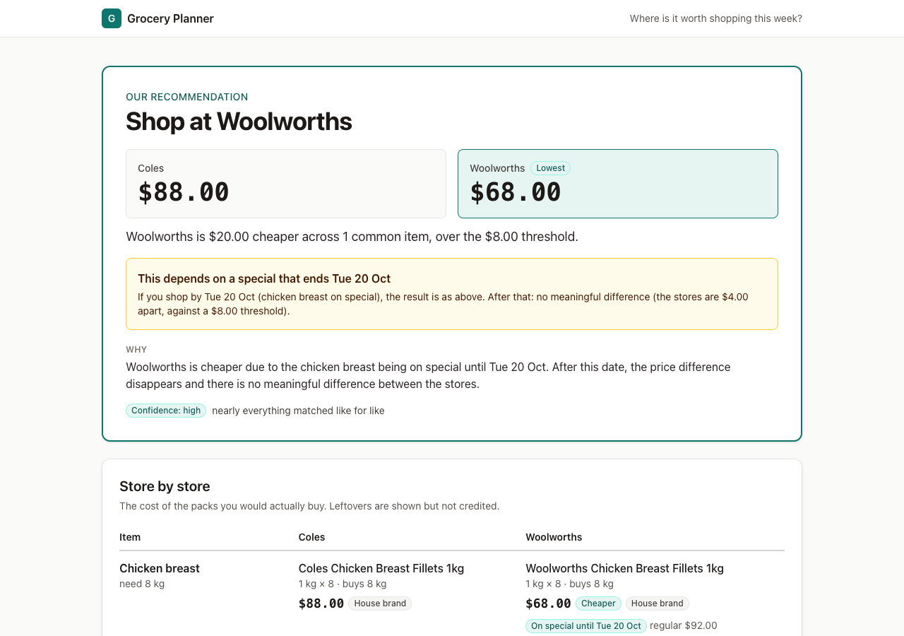
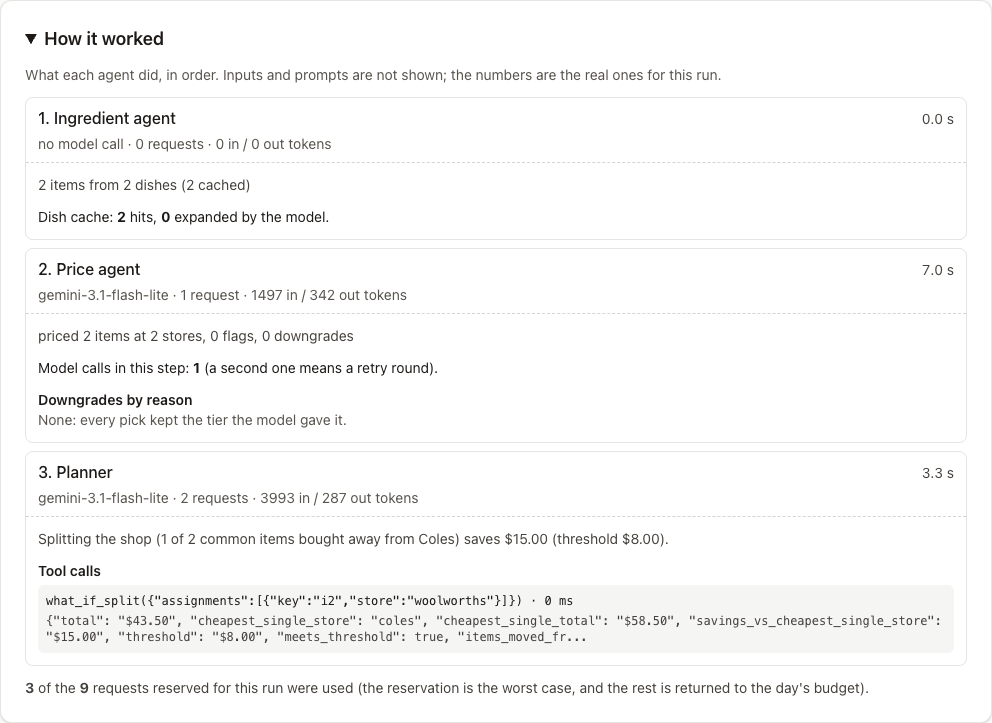

# Grocery Planner

A multi-agent grocery planner: meals in, shopping list, supermarket prices, and a where-to-shop recommendation out. Full design: [docs/Multi-Agent Grocery Planner Design Document.md](docs/Multi-Agent%20Grocery%20Planner%20Design%20Document.md). Choices the design doc left open are logged in [docs/DECISIONS.md](docs/DECISIONS.md).

**Status: step 12 of the build plan.** Backend complete: ingredient, price and planner agents, orchestrator, guardrails, tracing, evals, GitHub Actions and the HTTP API (create a run, read it, follow it over SSE). The frontend (form, live progress, result view) is in `frontend/`.

## Layout

```
backend/    Python 3.12 package `grocery_planner` (FastAPI, Pydantic v2, psycopg 3)
frontend/   placeholder (React + Vite later)
db/migrations/   plain-SQL schema
db/seed/         seeded price catalogue + EDGE_CASES.md
docs/       design doc and DECISIONS.md
```

## Setup and running tests

On a fresh Mac, install [uv](https://docs.astral.sh/uv/) with Homebrew; uv then fetches Python 3.12 itself. No network or database is needed to run the tests.

```bash
brew install uv
cd backend
uv sync
uv run pytest
uv run ruff check .
```

Tests marked `integration` need a real Postgres and are skipped when `SUPABASE_DB_URL` is not set. To run everything, copy `.env.example` to `backend/.env` (git-ignored) and set `SUPABASE_DB_URL`. To run only the offline tests:

```bash
uv run pytest -m "not integration"
```

## Seeded prices are fictional

Every price in `db/seed/price_catalogue.json` is made up for testing, in AUD, and plausible rather than real. Brand names other than Coles and Woolworths (Kingsway, Harvest Farm, Bellvue, Goldleaf) are invented. Nothing here comes from a supermarket. Every product carries `data_source: "seeded"`. See `db/seed/EDGE_CASES.md` for the deliberate test cases.

## Model layer and live tests

`grocery_planner/llm/` holds a provider-neutral `LLMClient`, a Gemini implementation (`GeminiClient`) and a scripted `FakeLLMClient` for tests. Set `GEMINI_API_KEY` (and optionally `GEMINI_MODEL`, default `gemini-3.1-flash-lite`) in `backend/.env`. If the primary model is unavailable the call is retried once on `GEMINI_FALLBACK_MODEL` (default `gemini-3.5-flash-lite`); set `GEMINI_FALLBACK_MODEL=none` (or build the client with `fallback_model=None`) to pin a run to one model, as evals should, and check `result.fell_back` / `result.model`. Normal test runs never call Gemini. The live smoke test uses a few free-tier requests:

```bash
uv run pytest -m live -s
```

## Running a plan from the command line

```bash
cd backend
uv run python -m grocery_planner.cli run examples/request_1.json            # stored in Postgres
uv run python -m grocery_planner.cli run examples/request_2.json --memory   # no database
```
The CLI refuses to start (exit code 3) when the day's AI budget is used up, and prints the per-model counters after every run. Options: `--as-of YYYY-MM-DD` (default today, Sydney), `--bypass-cache` (skip the dish cache), `--seed` (refresh the Postgres catalogue first), `--memory` (in-process store and the seed file). Exit code 0 completed, 1 stopped (too little to compare), 2 failed, 3 unavailable today. A request file is a plan request plus optional `parameters` (savings and stop thresholds).

## Run the API locally

```bash
cd backend
uv run uvicorn grocery_planner.main:app --port 8000          # Postgres, real Gemini (backend/.env)
API_STORE=memory uv run uvicorn grocery_planner.main:app     # no database, seed file prices
```

Interactive docs are at `/docs` when `APP_ENV=dev` (hidden otherwise). A plan, end to end:

```bash
curl -si -c jar -X POST localhost:8000/api/runs -H 'content-type: application/json' \
     --data @examples/request_1.json            # 202 {run_id, run_url, events_url}
curl -N localhost:8000/api/runs/<run_id>/events # server-sent events until run_completed
curl localhost:8000/api/runs/<run_id>           # the finished run
```

| Endpoint | Purpose | Status codes |
| --- | --- | --- |
| `GET /health` | liveness | 200 |
| `GET /api/availability` | open today? reset time, sample run id | 200 |
| `POST /api/runs` | start a plan (body: the meal form plus optional `parameters`) | 202; 400 bad JSON; 413 body over 32 KB; 422 field messages; 429 `visitor_limit` / `ip_limit`; 503 `unavailable` / `day_budget` / `busy` |
| `GET /api/runs/{id}` | public run view | 200; 404 |
| `GET /api/runs/{id}/steps` | step records for the "how it worked" panel | 200; 404 |
| `GET /api/runs/{id}/events` | SSE: replays from `Last-Event-ID` (or `?after=`), then live; heartbeat comment every 15 s; closes after `run_completed` or `run_failed` (a stopped run too); `queued` while waiting | 200; 404 |

Errors are `{code, message}`. Settings (see `.env.example`): `FRONTEND_ORIGINS` (CORS), `TRUSTED_PROXY`, `IP_HASH_SECRET` and `SAMPLE_RUN_ID` (both required with `APP_ENV=prod`, or the API will not start), `API_STORE=memory`. At most 2 plans run at once with up to 10 waiting; a 13th request gets 503 `busy`. The queue is in one process, like the per-minute limiter.

## Run the frontend

The app is `frontend/` (React, Vite, TypeScript, Tailwind). In production FastAPI serves the built app itself, so the page and the API share one origin: no CORS, and the visitor cookie just works. Unknown paths that are not `/api` return `index.html`, so a reload of `/runs/<id>` works.

```bash
# one terminal: the API
cd backend && uv run uvicorn grocery_planner.main:app --port 8000
# another: the dev server with hot reload (proxies /api to :8000)
cd frontend && npm ci && npm run dev          # http://localhost:5173

# or build once and let FastAPI serve it
cd frontend && npm run build                  # then open http://localhost:8000
```

Checks: `npm run typecheck`, `npm run lint`, `npm test` (Vitest and Testing Library), `npm run e2e` (a Playwright smoke test with every `/api` route mocked). The API types in `frontend/src/api/types.ts` are generated from the OpenAPI schema (`npm run gen:types`); CI regenerates them and fails if the committed file differs.

**Try an example.** The form has four ready-made plans, each checked against the seeded prices to give a different answer: a close call (Friday dinner), one store clearly wins (Sunday lamb), worth splitting the shop (lamb and pork weekend) and an answer that depends on a special ending soon (big chicken BBQ). They work because the seed has two deliberate price gaps (lamb chops are much cheaper at Coles, pork chops much cheaper at Woolworths) on top of the existing Woolworths chicken special.

**How it worked.** Every run page has a collapsed "How it worked" panel (it reads `/api/runs/{id}/steps`, so it works on shared links): one row per step with the model, requests, tokens and latency, expandable to cache hits, price downgrades by reason, tool calls (what-if split arguments and results) and how many of the run's reserved requests were used. No prompts are shown.

**Sample run.** `SAMPLE_RUN_ID` (the run shown when the day's free capacity is used up) should be a completed run that does not go stale. The split-the-shop run `f95caaf0-a6fc-4587-9395-7422e48bf67d` in the project's Supabase database is the one chosen; set it as `SAMPLE_RUN_ID` in production.





## Database: migrate, seed, integration tests

With `SUPABASE_DB_URL` set in `backend/.env`:

```bash
cd backend
uv run python -m grocery_planner.db.migrate          # applies db/migrations/*.sql once each, in one transaction
uv run python -m grocery_planner.db.seed             # upserts the catalogue; optional arg: anchor date YYYY-MM-DD
uv run pytest -m integration                         # price source equivalence, idempotent migrations, RLS check
```

Seed dates are relative ("special ends in 3 days"), so re-run the seed daily to keep specials current; it resolves against today in Australia/Sydney unless you pass an anchor date. The integration tests also run the seed with today's anchor.

To get plain SQL instead: `uv run python -m grocery_planner.tools.seed_sql [anchor] > ../db/seed/price_catalogue.sql`.

## Evals

`backend/evals/` holds 39 eval cases (12 ingredient, 12 price, 11 planner, 4 end to end) in `evals/cases/*.yaml`. Every check is deterministic (no LLM judge yet): required items, quantity ranges, avoid word lists, allowed product ids and tiers, pack gaps, specials, the planner's verdict, override reasons and "no invented dollar amounts". Runs use a separate key (`GEMINI_EVAL_API_KEY`, never the demo key), `APP_ENV=eval`, `bypass_cache=True`, the fallback model off, and a fixed `as_of` of 2026-10-14 (a Wednesday).

```bash
cd backend
uv run python -m evals.run                       # everything, default model
uv run python -m evals.run --agent planner       # one agent (repeatable)
uv run python -m evals.run --model gemini-3.5-flash-lite --repeat 3
uv run python -m evals.run --list
```

It writes `evals/results/<timestamp>-<model>.json` and a markdown summary, and exits 1 if an agent is more than 10 points below `evals/baseline.json`, below its floor (ingredient 85%, price 85%, planner 90%), or if any answer came from a fallback model. A full run takes about 5 minutes at the 12 requests a minute limit, so it is not part of the normal test run.

Request counting: a case's call limit counts model calls (first calls and tool rounds); repairs and transport retries (5xx, timeouts, per-minute 429s) are reported but never fail a case, and a per-day 429 stops the run with exit code 3 instead of producing failures. The three end-to-end cases all expect "no meaningful difference" because the seeded prices are close; the planner cases cover the other outcomes (one store, split, and the two overrides).

**Scores (approved baseline).** Pass rate over scored case runs, 3 repeats of every case, at the 2026-10-14 anchor, fallback model off. The ingredient, price and planner rows are from the full 39-case run on 2026-10-15; the end-to-end row for 3.1 is from the re-run after the stopped-run case was replaced (the 3.5 end-to-end figure still includes the old case).

| Agent | Cases | `gemini-3.1-flash-lite` (default), mean / min | `gemini-3.5-flash-lite`, mean / min |
| --- | ---: | ---: | ---: |
| Ingredient | 12 | 100% / 100% | 94.4% / 91.7% |
| Price | 12 | 100% / 100% | 100% / 100% |
| Planner | 11 | 100% / 100% | 100% / 100% |
| End to end | 4 | 100% / 100% | 91.7% / 75.0% |

Cost of one full set on the paid tier is about $0.19 for 3 repeats on 3.1 against $0.31 on 3.5 (roughly $0.06 and $0.10 a set); average latency per case is 6.3 s against 7.1 s (15.6 s against 21.0 s end to end).

**Why 3.1 is the default:** it is at least as accurate as 3.5 on this set and cheaper and faster. The two failures only 3.5 had are both ingredient cases: it put spaghetti and penne into a gluten-free bolognese on one repeat (both answers broke the avoid guard, so the repair failed), and on one repeat it returned the injected dish name as an ingredient. 3.1 needed no repairs at all.

The stop path (too many items not found, or too few comparable) is tested offline in `tests/test_orchestrator.py`: the run stops, keeps the ingredient list, gives the user a message and never runs the planner. The live end-to-end case `e2e-unusual-dishes` (dragon fruit, saffron and kangaroo) accepts either outcome and checks that any swapped food is named in the assumptions.

CI: `.github/workflows/ci.yml` runs ruff, the unit tests and the integration tests (against a Postgres service container) on every push and pull request. `.github/workflows/evals.yml` runs the evals when agents, prompts, the model layer, the evals, fixtures or the catalogue change, or on demand. It needs the repository secret `GEMINI_EVAL_API_KEY`.


## Known limitation: Supabase free tier pauses

Free Supabase projects can pause after inactivity. A keep-alive ping against `/health` (plus a cheap DB query) is planned; check Supabase's current free-tier terms before launch.

## Tracing (Langfuse)

Set `LANGFUSE_PUBLIC_KEY`, `LANGFUSE_SECRET_KEY` and `LANGFUSE_HOST` (the host of your project's region) in `backend/.env`; without the keys tracing is simply off, and `LANGFUSE_ENABLED=false` switches it off even with them. `APP_ENV` (`dev`, `eval` or `prod`) tags every trace.

Each run is one trace named `plan_run` (its id is derived from the run id and stored in `runs.langfuse_trace_id`): a span per step, a generation per model request, and the planner's what-if calls under the planner span. That is about 7 observations for a normal run, so the free plan (50,000 units a month) covers several thousand runs. The cost Langfuse shows is what the run would cost on Google's paid tier; the free tier actually charges nothing. Langfuse keeps 30 days of history, while `run_steps` stays in your database. The CLI prints the trace id and URL after a run.

A tracer error never affects a run. Tests use a recording tracer and an in-memory exporter, so no network is needed.

## Known limitations

- Per-visitor limits (5 runs per visitor and 20 per IP per Pacific day) rely on a cookie and an IP, so they can be bypassed by clearing the cookie or changing IP. There are no accounts.
- The per-minute request limiter lives in one process; running several backend processes would multiply the limit.
