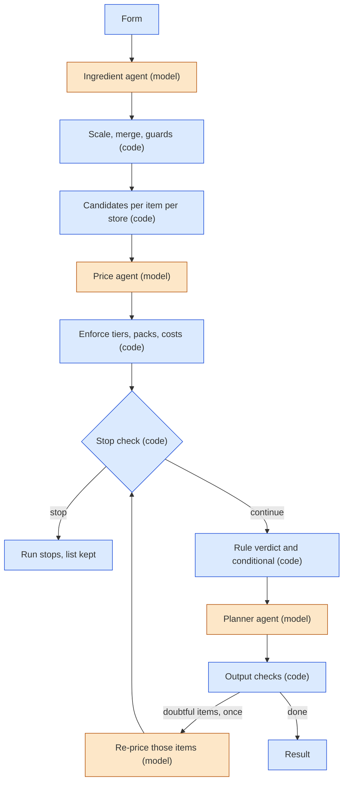

# Multi-Agent Grocery Planner: Design Document

Oct 13, 2026 · @Daniel · synced to the finished build on 2026-10-19 (v1.0.0). The history of every choice is in [DECISIONS.md](DECISIONS.md); the figures are in [NUMBERS.md](NUMBERS.md).

## Overview and goals

This is a public web app where a user describes the meals they plan to cook, and three agents turn that into a shopping list, supermarket prices, and a recommendation on where to shop this week. The goal is a small but properly run production AI system, not a product with scale.

**Goals**

- Show a multi-agent system with real judgment steps, tool use, and deterministic code where maths is needed
- Show production habits: structured outputs, cost control, tracing, evals in CI, failure handling, deployment
- Stay reliable on the free tier of the Gemini API, and say plainly when the service is unavailable for the day

**Non-goals**

- User accounts, payments, or personalisation
- Live scraping of supermarket sites in the MVP (prices are seeded, behind an interface built to swap)
- Route or distance optimisation (the planner decides on savings only; where the user shops is their call)
- Scale beyond a demo audience

## Architecture and run flow

A run moves through three agents in a fixed order, and only the planner can send work back, once.

Orange is a model call, blue is code.

## Final architecture

What runs in production (v1.0.0). This section only states the end result; nothing here is new design, and the reasons and the history are in DECISIONS.md.

- **One container on Google Cloud Run in Sydney** serves the React app and the FastAPI API from the same origin. It runs one uvicorn worker (the run queue, the per-minute limiter and the sweeps are in memory), at most one instance, scaled to zero when idle, with CPU kept on while an instance exists so a run continues after its POST returns, and a one-hour request timeout for the event stream. The image is built by Cloud Build; secrets come from Secret Manager; the service runs as a service account that can only write logs and read its five secrets.
- **Supabase Postgres** in Sydney, reached through the Session pooler, holds runs, step records, the seeded price catalogue, the dish cache and the usage counters.
- **Gemini 3.1 Flash-Lite** (fallback 3.5 Flash-Lite) on the free tier, through the in-house model layer, with a per-agent request timeout.
- **Cloud Scheduler** calls `POST /internal/daily` at 00:10 Sydney with a Google identity token the app verifies: it re-seeds the prices, sweeps, prunes and keeps the free database awake.
- **Langfuse** (Japan region) holds one trace per run; the public trace panel reads the app's own `run_steps`.
- **GitHub Actions**: CI on every push, evals when the agents or their inputs change, and a manual deploy that uses Workload Identity Federation (no keys).
- Commands, costs, rollback and the smoke test are in DEPLOY.md.

**Stack**

- **Backend:** Python and FastAPI, one background task per run, SSE for progress
- **Agents:** Gemini 3.1 Flash-Lite (free tier) behind a swappable model layer (a thin in-house layer over the google-genai SDK). If the primary model is unavailable or out of its daily quota, the same call is retried once on a fallback model (Gemini 3.5 Flash-Lite by default)
- **Data:** Supabase Postgres
- **Tracing:** Langfuse, plus step records in the app's own database for the public trace panel
- **Frontend:** React and Vite, served by the API
- **Hosting:** Google Cloud Run (Sydney), built by Cloud Build

## Input form

A form replaces free text so the agents start from structured input. The user adds one or more meals, and each meal has its own fields.

| Field | Type | Required | Notes |
| --- | --- | --- | --- |
| Meal name | text | yes | General name, e.g. "Friday dinner" |
| Mains | list of text | yes, at least 1 | e.g. fillet mignon, chicken nuggets |
| Minor sides | list of text | no | e.g. potato salad, fries |
| People | integer | yes | Range 1 to 12 |
| Days | integer | yes | Range 1 to 14 |
| Avoid | text | no | Per meal, e.g. "nuts" |

Two settings apply to the whole request:

- **Include pantry staples** (toggle, default off): salt, oil, pepper and similar are assumed to be at home and excluded unless the toggle is on.
- **Advanced settings** (collapsed panel): savings threshold, stop thresholds and pack-size tolerance, each with a default and a clamped range (see Configuration).

## Ingredient agent

This agent turns the meal form into one consolidated, quantity-scaled list of purchasable items, with its assumptions stated. It needs an LLM because the step is fuzzy: "potato salad" has no single recipe, and a script cannot decide which ingredients a dish probably needs.

**Input:** `meals[]` (each with meal name, mains, minor sides, people, days, avoid) and `include_pantry_staples`.

**Job**

1. Expand each dish into per-serving ingredients, in one batched model call per request for all dishes not already cached
2. Scale quantities by people × days (code)
3. Merge duplicates across meals into one list (code), by name and canonical unit, rounding countable items up to whole numbers
4. Name each ingredient from a catalogue-derived vocabulary of generic items, each with a canonical unit (an out-of-vocabulary name is allowed and flagged)
5. Respect each meal's avoid field by substituting, and say so in the assumptions

**Output per item:** name, quantity, unit, category (meat, produce and so on), which meals use it, a pantry-staple flag, an in-vocabulary flag, sanity flags for unusual amounts, and an optional brand that is filled only when the dish text explicitly names one. The output also carries a top-level `assumptions[]`.

**Rules**

- It maps to generic items, not store products. Matching to real products is the price agent's job, which keeps the two agents separate.
- Avoid is per meal, so the merged list reflects each meal's own constraints.
- It does not ask clarifying questions. A contradiction (for example avoid: dairy with a creamy potato salad) is resolved by substitution and noted.
- Names and units come from the vocabulary: the model must use a vocabulary name with its canonical unit when one fits, and code validates this (a mismatch triggers one schema repair). There is no unit-conversion tool.
- **Avoid guard:** a small table maps known avoid categories (dairy, gluten, nuts, peanuts, eggs, shellfish, fish, pork, beef, meat, soy) to the vocabulary items they forbid. Code normalises each dish's avoid text, matches the known categories, and if the model's output contains a forbidden item for that dish, it goes back for the one schema repair with the violation listed (a cached dish that breaks the current avoid counts as a miss). Avoid text that matches no known category is not checked and is logged as relying on the model alone.
- Dish expansion is cached per dish and normalised avoid text, written only after the output passes schema validation (see Data layer), and scaling, merging and rounding are code, not the model.

## Price agent

This agent finds a comparable product for each purchasable item at each store and works out what it costs to buy the amount needed. The built stores are Coles and Woolworths. Aldi exists in the store list but has no seeded rows, so it is not compared.

**Input:** the purchasable items list and the stores to check.

**Tool:** one price lookup that returns candidate products for a search term. At first it reads a seeded catalogue of 168 ingredients (602 products). It returns the same fields a live source would, including a price timestamp, so swapping sources later is a config change. Seeded specials and price ages are stored relative to an anchor date (default: today), so specials never go stale. **Specials run Wednesday to Tuesday**, as at Coles and Woolworths: a seeded special says which sale week it ends in (`special_weeks`: 1 is the Tuesday ending the week that contains the anchor, 2 the Tuesday after), and every special carries a `regular_price`, the shelf price once it is over (validated to be higher than the special price).

**Flow:** code pre-fetches up to five candidates per item per store (only the named brand when the user named one) and computes packs, purchased quantity, leftover, total cost, unit price and whether a special is active. One batched model call then picks a candidate per item per store, or none, with a tier and confidence. Code enforces the tier rules afterwards, downgrading and flagging any pick that breaks them. If a store had no usable pick and the model suggested search terms, there is one retry round (a single extra model call). The planner's loop-back reuses the same machinery.

**Judgment calls**

- Choose the best match from the candidates
- Accept a pack count worked out by code (400g needed, 500g pack, so one pack)
- Retry with a different search term when nothing matches
- Suggest a substitute or mark the item not found
- Flag low-confidence matches

**Matching rules**

- **User names a brand:** match that exact brand at every store.
- **Generic item ("bacon"):** pick the best-value acceptable product at each store, branded or house brand, from products of the same type and a comparable quality band. A popular brand on special can beat the house brand.
- Each pick is labelled house brand, branded, or on special.
- The agent flags when a price gap comes from a tier difference rather than the store's pricing, so savings are not fake.
- **Same food:** every catalogue product belongs to exactly one generic ingredient, the one it was seeded under (coconut milk is not milk, hash browns are not potato gems). An exact or equivalent pick must be the item's own ingredient (its vocabulary name or one of that ingredient's search terms); otherwise code caps it at substitute and records a `different_food` downgrade. This is code, not prompt.
- **Pack-size tolerance:** pack size never changes a match tier, which depends only on the product (type, quality band, and brand for exact). Instead, code compares the quantities each store's pick makes you buy (packs × pack size): if they differ by more than 15% (relative to the smaller), the item gets a `pack_gap` flag carrying both quantities. Leftover is shown, not credited.

**Match tiers per item per store**

| Tier | Meaning | Used in comparison |
| --- | --- | --- |
| Exact | Same brand and product at both stores | Yes |
| Equivalent | Comparable product in the same quality band | Yes, with tier flagged |
| Substitute | Nothing comparable; closest alternative | Flagged, excluded from like-for-like totals |
| Not found | No usable product | Excluded and counted toward stop thresholds |

**Cost basis:** the cost of the packs actually bought, not a prorated amount. Leftover quantity is noted but not credited.

**Output per item per store:** product name, brand label, pack size, price, unit price, special (yes or no and end date), regular price, packs needed, total cost, regular total cost (the same packs at the regular price; equal to the total cost when not on special), match tier, match confidence, status, price timestamp, and `data_source` (seeded for now).

**Deliberate demo gaps:** most seeded prices are within a few percent of each other, so the demo examples rely on two deliberate gaps on items no eval case or fixture references: lamb chops (house brand) are $7.50 at Coles against $12.50 at Woolworths, and pork chops $4.50 at Woolworths against $9.50 at Coles. The examples also use the existing Woolworths chicken special for the conditional verdict.

**Seeded edge cases for evals:** an item missing at one store, mismatched pack sizes, a special ending at the end of the sale week, and a near-identical basket total.

## Planner agent

This agent decides where it is worth shopping this week based on savings alone. It is not a route planner, and "no meaningful difference" is a complete, valid outcome: the user then shops wherever suits them. There is no home store field.

**Input:** each store's basket from the price agent (items, prices, match tiers, statuses).

**Deterministic tools** (code does all the arithmetic before the call; during it the agent may call the what-if tool, at most two rounds, and interprets the results):

- Basket total per store, on common items only
- Per-item savings between stores
- What-if split totals, e.g. "meat from store B, everything else from store A" (the one tool the agent can call itself)

**Decision rule:** one threshold applies to every outcome: $8 or 8% of the basket, whichever is higher, set in config. A split only wins if its savings meet the threshold after accounting for the extra trip. Otherwise one store wins if its lead over the next cheapest store meets the threshold, and anything less is no meaningful difference. Code computes this rule verdict, and the agent follows it. The only override reason is doubtful matches (`match_quality`).

**Conditional verdict:** code computes the verdict twice, at current prices and with every pick on special put back to its regular price. If the two recommendations differ, the verdict stays the current-price one and carries a condition: `valid_until` (the earliest end date among the specials that change the outcome, tried one at a time, or all of them together if none does alone), `items` (those items) and `fallback` (the regular-price verdict with its numbers). If they agree, the condition is null. The agent does not override for a special: it follows the verdict and explains the condition, and the summary line states it, for example "Woolworths is $11.40 cheaper if you shop by Tue 20 Oct (beef mince special); after that, no meaningful difference." If one store is cheaper overall but another is cheaper on one expensive item, the agent only recommends a split when it clears the threshold, and otherwise mentions the item as a tip.

**Checks on the agent's output:** a recommendation that differs from the rule verdict needs the override reason `match_quality` (doubtful matches); when the verdict has a condition, the reasoning must state the date it holds until; a split is recomputed by code and must meet the threshold; tips are limited to items whose store difference is at least a quarter of the threshold, must give the end date when they mention a special, and assumptions may only cover data and pricing, never the shopper's preferences; every dollar figure in the text must equal a number code provided or a tool returned. Anything else goes back to the agent for one repair.

**Incomplete baskets:** if a store lacks a few items, the planner compares on common items and flags the gap.

**Output**

- `recommendation`: one\_store (which), split (which items where), or no\_meaningful\_difference
- `savings`, and `reasoning` in at most two plain sentences on what drove the result (which items, how many stores are cheaper on how many items, specials, gaps), never restating the verdict or telling the shopper to shop "with confidence"; a one-line summary is rendered by code from the numbers
- `confidence`, computed by code from the share of comparable items, match confidence and tier or pack gaps (the agent does not set it)
- `flags[]`: items missing at a store, specials ending within 7 days (information, with each end date), substitute matches, tier and pack gaps
- `assumptions[]`

**Loop-back:** the planner may send low-confidence items back to the price agent once. After that it must decide with what it has.

## Orchestrator

The orchestrator runs the three agents in a fixed sequence, with one controlled loop-back. It is predictable and cheap, and the loop-back keeps it agentic.

**Flow:** ingredient agent, then price agent, then the stop check, then the planner. If the planner returns doubtful items, the price agent re-prices just those (with the planner's hints), the stop check runs again, and the planner runs once more with no further loop-back. Never a third pass.

**Failure handling:** when too much is missing for a comparison to mean anything, the run stops and tells the user. Otherwise it continues.

| Situation | Behaviour |
| --- | --- |
| A few items missing at one store | Planner runs on common items and flags the gap |
| More than 25% of items not found at any store | Stop and tell the user |
| Fewer than 50% of items comparable across all stores | Stop and tell the user |
| Transient error (timeout, rate limit) | Automatic retry with backoff, then one retry on a fallback model, before counting as a failure |
| Output that fails validation twice, model unavailable, or quota used up | Run fails with a clear message; the ingredient list and every completed step are kept. Daily quota exhaustion is recorded as `daily_quota` for the day-stop logic |
| Provider billing refusal (HTTP 402) | Not retried; one fallback attempt; then the run fails as `provider_billing` and the day stops (see Guardrails) |
| Run takes longer than 180 s | Run fails with reason `timeout` |
| Run stops writing for 5 minutes | A sweep marks it failed (`stale`) |
| Item not found | Never retried blindly; this is what the loop-back is for |

When a run stops, the user still sees the ingredient list that was built, plus which items failed and why, so they can shop from the list.

**Execution model:** each run is a background task that writes every step to the database (steps: ingredient, price, planner, reprice, planner_2, stop) and refreshes a heartbeat as it goes. It does not depend on the browser connection, so a closed tab does not abandon a run. The event stream (`step_started`, `step_completed`, `loopback`, `run_completed`, `run_failed`, which is also used for a stopped run) is derived from the stored run and steps, each event with an increasing number, so a client can reconnect and resume from any point. Before a run starts the orchestrator reserves its worst-case request count (9) with a budget guard and releases it at the end; the guard records every request with the model that served it.

**User-controlled parameters:** the end user can change the savings threshold, stop thresholds and pack-size tolerance in the advanced settings panel. Each has a default and a clamped range. The settings used are stored with each run so results are reproducible. Retry and backoff settings stay developer-side.

## Data layer

The database is Supabase Postgres, with plain SQL so the schema stays portable. There are no user accounts: runs are anonymous and shared through links.

| Table | Holds | Purpose |
| --- | --- | --- |
| `runs` | Form input, parameters used, each agent's output, status, stop or failure reason, the message shown to the user, models used, requests, tokens, cost, latency, Langfuse trace ID | Run page, trace panel, evals |
| `run_steps` | Per-step records: step name, inputs, outputs, tool calls, requests, tokens, model and whether the fallback answered, latency, a one-line summary | Public trace panel and SSE replay |
| `price_catalogue` | Store, product, brand, pack size, price, special and end date, timestamp, `data_source` | Seeded prices behind the lookup tool |
| `dish_cache` | Dish, normalised avoid text and prompt version to per-serving ingredients | Avoids repeat LLM calls for the same dish |
| `usage_counters` | Per-visitor and global daily token counts, day-stop flag | Guardrails |
| `visitors` | An HMAC of the visitor cookie id, first and last seen, run count, owner flag. No `run_id` and no IP | The usage counter: unique and returning browsers |

**Caching:** only the dish expansion is cached, keyed on the dish, its normalised avoid text and the ingredient prompt version (a prompt change makes old rows miss), and a row is written only after the ingredient agent's output passes schema validation. The planner's output is never cached, because it depends on prices and parameters. Scaling by people and days is deterministic code.

**Access:** the browser never talks to Supabase directly. Only the backend does, using the service key. Row Level Security is enabled on every table anyway, so a leaked public key exposes nothing.

**Run links:** run IDs are long random values, not sequential numbers. The UI says that anyone with a link can view the run. Runs hold nothing personal; the free-text avoid field is the only place a user might type something sensitive, so a short notice sits beside it.

**Operations:** free Supabase projects can pause after a period of inactivity, which would break the demo. In production Cloud Scheduler calls an authenticated endpoint (`POST /internal/daily`, a Google OIDC token checked for issuer, audience and the scheduler's service account) every day at 00:10 Sydney time. The job re-seeds the price catalogue with today's Sydney date (the seeded specials are relative dates), closes stale and orphaned queued runs, prunes old counters, and its writes keep the free Supabase project active. It runs on a single Cloud Run instance in Sydney (min 0, max 1, CPU always allocated while the instance exists, request timeout one hour for the event stream) behind the Session pooler of the Supabase project; secrets come from Secret Manager and the container is built by Cloud Build. The runbook is `docs/DEPLOY.md`. Check the current free-tier terms of Supabase.

## Guardrails

Guardrails protect the free Gemini quota and keep a single run from costing too much. When the day's budget is used up, the service stops for the day and says so.

**Budget and day stop**

- The budget is counted in requests, not runs, because requests per day (500 on the free tier) is the binding limit and a five-meal run sends far more requests than a one-meal run. Tokens are still tracked for cost and traces.
- A run reserves its worst-case request count (9) when it starts, in one atomic database statement, and releases whatever it did not use when it finishes (even if it fails). This stops ten simultaneous runs from overshooting the budget. Counters are kept per model and per Pacific day.
- New runs are admitted only while used plus reserved plus the new estimate fits under the admission limit: the daily limit minus a 15% buffer (298 of 350). Runs already started can use the buffer to finish, up to the daily limit.
- The fallback model has its own counter and daily limit. When it is used up, or Google says its daily quota is gone, the fallback is switched off for the rest of the day and calls behave as if none were configured.
- The day is flagged stopped when the primary can no longer admit runs, or when Google returns a per-day quota error for the primary, whatever our counter says.
- A billing refusal from Google (HTTP 402, credits depleted) is never retried and falls back once; if the fallback fails too the day stops with the reason `provider_billing`. The screen then says "Temporarily unavailable" with no reset time (nothing resets a billing problem by itself) and still links the sample run. It is cleared by hand once the credit is fixed (DEPLOY.md).
- A per-minute limiter in the model layer (12 requests a minute per model) makes a request wait for a slot, up to 30 seconds, then fails as unavailable.
- Once the cutoff is hit, the form is replaced by an "unavailable today" message with the reset time and a link to a sample run.
- If the buffer itself runs out mid-run, that run fails cleanly with a clear message.
- The internal budget is set below Google's current free-tier limits, which can change. A quota error (429) from Google flips the same day flag. Per-minute limits are watched too, since a burst of users can hit them before the daily limit.

**Per-visitor limits:** with no login, "per user" means an anonymous browser ID in a cookie plus an IP cap: 5 runs per visitor and 20 per IP per Pacific day. The IP is stored only as a hash with a salt that changes every day. This is not bulletproof, and the README names it as a known limitation.

**Visitor id and the usage counter:** the visitor id is a random value in a cookie. It is used raw only for the per-day counters, which are deleted after 7 days. The usage counter (`visitors`) keeps only its HMAC-SHA256 under a stable server secret (`VISITOR_HASH_SECRET`), never the raw id and never an IP, in a table that has no `run_id`; the one thing a run record carries is an owner flag (a boolean, not an id) so the owner's runs can be left out of the totals. Hashes and ids appear in no API response and no log. The stats endpoint is for the scheduler's service account only, and counting starts at deploy (no backfill).

**Input validation:** length limits and type checks on every field, the ranges 1 to 12 people and 1 to 14 days, and at most 20 dishes (mains plus sides) across all meals, which together cap the cost of any single run. The planner's what-if tool is only offered when the best possible split could clear the savings threshold; otherwise it could not change the answer and the planner makes a single plain request.

**Prompt injection:** all form fields are treated as data, never as instructions. Every agent output is validated against its schema, and no agent has a tool that can do anything harmful. Code also guards the ingredient agent's output: an out-of-vocabulary ingredient name must be at most 4 words and 40 characters, use only letters, spaces, hyphens and apostrophes, and not repeat 3 or more words of the dish text it came from; a violation gets the one repair, and if it persists the item is dropped with an assumption and nothing is cached. This bounds the damage; it does not eliminate injection (a model that returns a single odd word as a name is not caught). A visible "flagged input" path is out of scope for the demo.

## Observability and evals

Tracing shows what each run did, and evals show whether a prompt or model change made the agents better or worse. This is the part that most separates a demo from a production system.

**Tracing**

- Langfuse (SDK v4) records one trace per run, named `plan_run`, with the run id as its seed so a run and its trace always match. Tags are the environment (dev, eval or prod, from `APP_ENV`), the prompt versions and the primary model; metadata holds the date used, the number of meals and dishes, and the settings used. No visitor id or IP ever goes in. It is the developer's debugging view.
- Lean by design, about 10 billable units per run (the free plan includes 50,000 a month, with 30 days of history): one span per orchestrator step, one generation per model request (retries, repairs, the fallback model and tool rounds each get their own, with model, tokens, latency, attempt and the error class), and the planner's what-if calls as child spans of the planner span. A normal run is 7 observations, a run with the loop-back 11. Catalogue searches, packing and the planner's arithmetic get no spans; the step span carries one summary (searches, candidates, cache hits).
- Generations store the user payload and the model output in full, and the system prompt as its versioned name (for example `planner@3`) rather than its text.
- Cost shown in Langfuse is what the request would cost on Google's paid tier, using the paid price of the model that answered (prices and the date they were checked live in code); the free tier actually charges nothing. The run's total is stored on the run as `would_cost_usd`.
- Tracing never breaks or slows a run: every tracer error is caught and logged, export is batched in the background, and the run waits at most a few seconds to flush at its end. With no Langfuse keys, tracing is off.
- Run summaries and parameters live in the `runs` table, with the Langfuse trace ID stored on each run so the two link up. Langfuse keeps 30 days; the `run_steps` records are the permanent record.
- The public "how it worked" panel reads from the app's own `run_steps` records, not from Langfuse, so it works on shared links without exposing the tracing account.

**Evals:** 39 cases in `backend/evals/cases/*.yaml`, split by agent. Each case has an id, the agent, an input, a set of checks and a note on why it exists. **Every check is deterministic; there is no LLM judge yet.** A judge is a later addition if a fuzzy question (for example whether a potato salad list is sensible) turns out to matter.

| Agent | Cases | What is checked | Method |
| --- | ---: | --- | --- |
| Ingredient | 12 | Required vocabulary items present (any-of groups allowed); per-serving quantity inside a range per item; forbidden items absent for each avoid (word lists, so coconut milk is not dairy); a brand only when the dish names one; merged lines list every meal that uses them; schema valid; one request | Checks on the typed output. Cases include classic dishes, a shared-ingredient merge, avoid dairy, nuts and gluten, a contradiction (creamy and dairy-free), an odd dish name and a prompt-injection dish name |
| Price | 12 | Product is in the allowed set for that store; tier is one of the allowed tiers; `not_found` where the seed lacks the product; exact for a named brand; `pack_gap` raised or absent as designed; the special is picked when it is the best value; best value among the acceptable products; pack counts; at most two requests; downgrades counted | Checks against the seeded catalogue. The input is a fixed ingredient list |
| Planner | 11 | Recommendation, store, override and its reason (`match_quality`), the verdict's condition (valid until, fallback) and that the reasoning states it; every dollar figure in the text is a number code provided or a tool returned; tip rules; confidence level; the what-if tool is only called when a split can win | Checks against the saved price-agent fixtures and constructed baskets. Code fixes the rule verdict, confidence and flags, so those are asserted offline as well |
| End to end | 4 | The run completes within the 9-call budget with the expected recommendation, or (the stopped-run case) stops with the ingredient list kept, a user message and no planner step | Full orchestrator runs |

**How a run is made reproducible:** the runner uses the eval API key (`GEMINI_EVAL_API_KEY`, never the demo's), `APP_ENV=eval`, `bypass_cache=True` (nothing read from or written to the dish cache), the fallback model switched off so one pinned model answers (a case fails if anything else did), and a fixed `as_of` of 2026-10-14 (a Wednesday, the first day of a sale week) so seeded specials and ages never drift. Temperature stays at the agents' 0.1, so a case can pass in one run and fail in the next; `--repeat N` measures that.

**What counts as a request:** checks count model behaviour, not infrastructure. A case's call limit counts first calls and tool rounds; repairs are counted and reported next to it, and the end-to-end budget (9) counts repairs too. Transport retries (5xx, timeouts, per-minute 429s) are reported per case and per run but never fail a case. A case lost to such an error after its retries is not scored (it is listed, and a run with more than 25% of an agent's runs lost this way fails the gate as untrustworthy). A per-day 429 stops the whole run with a clear quota status (exit code 3) and nothing is graded.

**Scores and the baseline rule:** the runner reports cases passed over total per agent, a pass rate for every check name, and the requests, tokens, would-be cost, downgrades and repairs used. `evals/baseline.json` holds each agent's pass rate from the last approved run. A run fails (exit code 1) when any agent's pass rate is **more than 10 points below its baseline**, **below an absolute floor** (ingredient 85%, price 85%, planner 90%), or when any answer came from a fallback model. The end-to-end cases have no floor of their own: with three cases one failure is a 33-point drop. After a deliberate prompt or model change, the baseline is rewritten by hand (`--write-baseline`) and reviewed like code.

**When they run:** in GitHub Actions, in `evals.yml`, on a push or pull request that touches the agents and their prompts, the model layer, the planner tools, the evals, the saved fixtures or the seeded catalogue, and on demand (`workflow_dispatch`, with a model and repeat count). The job summary shows the markdown report and the result JSON is uploaded as an artifact. Lint, unit tests and the integration tests against a throwaway Postgres run on every push in `ci.yml` and need no API key. The README shows the scores from the last approved run.

**Practical points**

- Evals use a separate API key or project, so CI cannot use up the demo's daily budget. The runner refuses to start without it, and refuses a key equal to the demo key.
- The eval set stays small, because a full run on the free tier is slow: the per-minute limiter (12 requests a minute) makes a full run take several minutes.
- Google may use free-tier inputs to improve its products, so no real personal data goes into eval cases or traces.
- The expected values are written from the catalogue and the design rules, not from model output, and are reviewed before they become the baseline.

## Frontend

The frontend is a React single-page app built with Vite, calling the FastAPI backend directly. Next.js is avoided because it adds a server layer that is not needed and makes SSE proxying harder.

**Screens**

1. **Form:** a repeatable meal card, an "add another meal" button, the pantry staples toggle, and a collapsed advanced settings panel
2. **Progress view:** the three agents in order, with the current step highlighted
3. **Result view:** the consolidated shopping list, a per-store basket comparison, and the planner's recommendation with reasoning, confidence and flags. A visible `data_source: seeded` label shows where prices come from.
4. **Run page:** the shareable link, which is the same result view, read-only. It doubles as the recorded-run demo.
5. **Unavailable today:** the message with the reset time and a link to a sample run

**Live progress with SSE:** the backend runs the pipeline as a background task and writes each step to the database. SSE only streams those events, so a closed tab or dropped connection does not stop the run. The event types are:

- `step_started`
- `step_completed` (with a short summary)
- `loopback`
- `run_completed`
- `run_failed` (also used for a stopped run)

`unavailable` is not a stream event: the form reads `/api/availability`.

On a reconnect, the client reloads the run's stored state and then resumes streaming. The chosen host must allow long-lived streaming responses, since some serverless platforms cut them off.

**Trace panel:** a collapsed "how it worked" panel on the result page shows each step's model, requests, tokens, latency, tool calls, price downgrades and cache hits, read from `run_steps`. It never shows prompts or step inputs.

**Built (step 13).** One React 19 app, Vite, strict TypeScript, Tailwind 4, react-router, with three routes: `/` (the form), `/runs/:id` (progress while running, the result when done) and a not-found page. It is served by FastAPI from `frontend/dist` on the same origin as `/api` (index.html for unknown non-API paths), so there is no CORS and the HttpOnly visitor cookie works; in development Vite proxies `/api` to :8000. The API types are generated from the OpenAPI schema and CI fails if they are stale.

- **Form:** repeatable meal cards (name, mains and sides lists, people, days, avoid with a note not to enter anything personal), a pantry staples toggle and a collapsed Advanced settings panel showing each default and range. Client-side validation mirrors the API caps (7 meals, 4 mains and 4 sides per meal, 20 dishes in total, text lengths); server 422 field errors are mapped onto the same inputs. A closed day shows a simple notice with the reset time and a link to the sample run; a busy or limit refusal shows the API's own message (limits add when they reset).
- **Progress:** the three agents in order with the current one highlighted, the queue position, and the loop-back rows when the planner sends items back. It is driven by the event stream: a fresh page load replays from event 0, which rebuilds the view, and our own reconnects use `?after=<last seq>`. An `aria-live` region announces each change.
- **Result:** the recommendation first (verdict in plain words, the code summary line, the condition "if you shop by Tue 20 Oct ... after that ...", confidence, saving, reasoning), then the per-store comparison (pack, cost, tier and flags per pick, totals on common items, excluded items listed), the consolidated shopping list by category with the meals that use each item, tips, flags and assumptions, and a footer (seeded-data notice, requests, latency, model, would-be cost, copy link, "anyone with this link can view this run"). A stopped or failed run shows the message, the ingredient list if there is one and which items failed and why.
- **Result hero (step 14):** the verdict, then the two store totals as large numbers side by side (the lower one marked; for a split they are the split total, highlighted, and the cheapest single store's total, with a line naming which items go to which store, and no store is marked "Lowest"), then the gap and the threshold in one plain line, then the condition if there is one, then the reasoning under a small "Why" label and the confidence. The code's summary line stays in the API but is not shown. **How it worked:** a collapsed panel on every run page, loaded from `/api/runs/{id}/steps` on first open (so it works on shared links): a row per step (model, requests, tokens, latency, fallback), expandable to dish-cache hits, price downgrades by reason, tool calls and the requests used against the run's reservation; no prompts. **Examples:** four buttons fill the form with plans verified to give a close call, one store, a split and a special-driven verdict. **Unavailable:** when the day's capacity is used up the form is replaced by a clear message, the reset time in the viewer's own time zone, one line on why (a free-tier demo) and a link to the sample run; a busy refusal keeps the form and asks to try again in a minute.
- **Design:** mobile first; one accent colour; the comparison reads like a receipt (dashed rules, tabular figures). Labels on every input, keyboard navigable, visible focus, reduced-motion respected.

## API

FastAPI, JSON in and out, errors as `{code, message}` (validation errors add `fields`; `unavailable` adds the reset times). No stack trace ever leaves the server.

| Endpoint | Purpose |
| --- | --- |
| `GET /health` | Liveness |
| `GET /api/availability` | `{available, reason, message, reset_at_utc, reset_at_sydney, sample_run_id}` for the form and the "unavailable today" screen. `reason` is `day_budget`, `google_quota` or `provider_billing`; for `provider_billing` both reset times are null |
| `POST /api/runs` | Body: the meal form plus optional `parameters` (the advanced settings). 202 `{run_id, run_url, events_url}` |
| `GET /api/runs/{id}` | The public run view: request, parameters used, status, ingredient list, per-store comparison, recommendation (with the verdict's condition), flags, assumptions, totals, models and would-be cost. 404 for an unknown id |
| `GET /api/runs/{id}/steps` | Public step records for the trace panel: summaries, tool calls, tokens, latency, model, fallback, the error class name only |
| `GET /api/runs/{id}/events` | Server-sent events (below) |
| `GET /internal/stats` | Not in the OpenAPI schema. Total runs, runs by status, runs per day (last 30 days), unique and returning visitors, all leaving out the owner. Only the scheduler's service account (a Google ID token, checked like `/internal/daily`) may call it |
| `GET /internal/owner?token=` | Not in the OpenAPI schema. With the right `OWNER_TOKEN` (compared in constant time) it sets a 400-day cookie and answers 204, so that browser's runs and visits are left out of the stats |

**Order of checks on `POST /api/runs`:** validate the body (422, 400 for bad JSON, 413 over 32 KB) → is the service open today (503 `unavailable`) → is there room in the queue (503 `busy`) → reserve the run's worst-case budget (503 `busy` or `day_budget`) → admit the visitor and IP (429 `visitor_limit` or `ip_limit`, and the reservation is released) → queue the run (503 `busy` if the queue filled in the meantime, reservation released) → 202. A refusal before admit never touches the visitor's count. The run row is written before the reservation because the budget records the reservation against it; a refused request deletes the row again.

**Queue:** a worker pool of 2 concurrent runs (configurable) behind a FIFO of at most 10; the 13th concurrent request is refused. Runs are plain background threads, so a closed tab or dropped connection changes nothing. The queue is in one process and is lost on a restart: a queued run that never started is left as queued (known limitation).

**Events:** `step_started`, `step_completed`, `loopback`, `run_completed`, `run_failed` (also a stopped run, `data.status` says which), each with `id` = its sequence number, replayed from `Last-Event-ID` or `?after=` and then followed live. While a run waits for a worker the stream sends `queued {position}` (no id, so a reconnect is unaffected). A comment heartbeat goes out every 15 s, and the stream closes after the terminal event. `unavailable` is not a stream event: the form reads `/api/availability`.

**Visitor and address:** a random visitor id in an HttpOnly, SameSite=Lax cookie (Secure in prod, one year). The client IP is the socket address, or with `TRUSTED_PROXY=true` the last `X-Forwarded-For` entry, which is the one our own proxy added. Visitor ids and IP hashes are used for the per-day counters only and appear in no response or run record; the usage counter keeps only a keyed hash of the visitor id (see Guardrails).

**Startup and hardening:** stale runs are swept at startup and every 5 minutes, and usage counters older than 7 days are pruned daily. With `APP_ENV=prod` the API refuses to start without `IP_HASH_SECRET`, `SAMPLE_RUN_ID` and `VISITOR_HASH_SECRET`. CORS allows only the origins in `FRONTEND_ORIGINS`, and `/docs` and `/openapi.json` exist only with `APP_ENV=dev`.

## Configuration parameters

Every parameter has a default and a clamped range, and the values used are stored with each run.

| Parameter | Default | Range | User-editable |
| --- | --- | --- | --- |
| Savings threshold for a split | $8 or 8% of the basket, whichever is higher | $3 to $25, or 3% to 20% | Yes |
| Stop if items not found at any store | 25% | 10% to 40% | Yes |
| Stop if fewer items are comparable across all stores (`stop_comparable_pct`) | 50% | 40% to 80% | Yes |
| Pack-size tolerance (purchased quantities across stores, raises a `pack_gap` flag, never changes the tier) | 15% | 5% to 25% | Yes |
| People per meal | None | 1 to 12 | Form field |
| Days per meal | None | 1 to 14 | Form field |
| Include pantry staples | Off | On or off | Yes |
| Model | Gemini 3.1 Flash-Lite, free tier | Swappable | No |
| Daily budget | 70% of 500 requests/day = 350 requests | Fixed | No |
| Sale week | Specials run Wednesday to Tuesday; seeded `special_weeks` 1 or 2 resolves to the Tuesday ending the sale week that contains the anchor, or the next | Fixed | No |
| Eval anchor | 2026-10-14 (Wednesday) for evals and tests; the app uses today in Sydney | Fixed | No |
| Daily reset boundary | Midnight Pacific time, matching Google's quota reset | Fixed | No |
| In-flight buffer | 15% of the daily budget: new runs are admitted up to 298 requests, in-flight runs can reach 350 | Fixed | No |
| Fallback model budget | Its own counter, same 350 limit; switched off for the day when used up | Fixed | No |
| Per-minute limiter | 12 requests per minute per model, wait up to 30 s | Fixed | No |
| Visitor and IP limits | 5 runs per visitor, 20 per IP, per Pacific day | Fixed | No |
| Dishes per request | At most 20 (mains plus sides) | Fixed | No |
| Run deadline | 180 s | Fixed | No |
| Retries and timeouts | Per-request timeout by agent: ingredient 12 s, price 25 s, planner 12 s (20 s elsewhere; override `GEMINI_TIMEOUT_<AGENT>_S`, clamped to 8 to 25 s); timeouts and 504 retried once; other transient errors 3 attempts with backoff 1s, 2s plus jitter; 429s honour retryDelay up to 20s; a 402 is never retried | Fixed | No |
| Schema repair | 1 attempt when an agent's output fails validation | Fixed | No |
| Loop-back count | 1 | Fixed | No |

## Known limitations and what I would change at scale

| Limitation | Why it exists | What changes at scale |
| --- | --- | --- |
| Prices are seeded, not live | Live prices from the stores' sites were considered and dropped: automated retrieval may breach their terms, and showing their prices to visitors goes beyond personal use. The seed was expanded instead | A live source needs a licensed or permitted feed, behind the same lookup interface, with freshness checks |
| Per-visitor limits use a cookie and IP, and can be bypassed (clear the cookie, change IP) | No accounts, to keep friction low | Authenticated users and per-account quotas |
| The usage counter counts unique browsers, not people: clearing cookies or using another device inflates it, and page views without a run are not counted | No accounts, and no tracking of anyone who does not start a run | Authenticated users, and a page-view counter only if it can be cookieless |
| The per-minute limiter lives in one process | Demo scale, one backend | A shared limiter (database or cache) |
| Default model is 3.1 Flash-Lite, not 3.5 | 3.5 Flash-Lite had a transient outage at build time | the default model is chosen by eval score (step 11); the probe command (`python -m grocery_planner.llm.probe --model gemini-3.5-flash-lite`) re-checks a model with one request |
| One free-tier model provider | Cost | A swappable model layer already exists; add fallback providers and paid quota |
| Free-tier quota can run out for the day | Cost | Paid tier, request queue and priority for in-flight runs |
| Fixed agent sequence with one loop-back | Predictable and cheap | A supervisor that chooses steps, if evals show it helps |
| Small eval set of about 30 to 40 cases | Free-tier speed limits | Larger sets, production sampling and drift monitoring |
| Database connections from a single backend | Demo scale | Connection pooling and read replicas |
| Run links are public to anyone with the link | No accounts | Private runs and expiry |
| One Cloud Run instance (`max-instances 1`) | The run queue, per-minute limiter and sweeps are in memory | A shared queue and limiter (database or cache), then more instances |
| Dev and prod share one Supabase database and one Gemini quota | One free project of each | Separate environments and a paid, per-environment key |
| Cold start of about 7 s after idle | Scale to zero keeps an idle demo free | `--min-instances 1` (about $50 a month) |
| Gemini keys are kept in unbilled projects | A leaked key cannot run up a bill | A paid key with a hard budget cap, once there is real traffic |

## Open items (all closed)

- [x] Read the Gemini 3.1 Flash-Lite limits from the AI Studio rate-limit page, then set the daily budget and buffer. Closed: 500 requests a day as shown in AI Studio for this project's models (checked by Daniel on 2026-10-14; Google can change it); 70% is 350 and a 15% buffer gives an admission limit of 298 (DECISIONS.md, steps 4, 9 and 16b).
- [x] Check Google's deprecations page for 2.5 Flash-Lite before building (done: 2.5 is limited to existing users, so the build started on 3.5; the default became 3.1 after a 3.5 outage and the eval comparison)
- [x] Hosting that allows long-lived streaming responses: Google Cloud Run, with a one-hour request timeout
- [x] Whether the first seeded catalogue covers Aldi or only Coles and Woolworths: only Coles and Woolworths (Aldi is a store-list entry with no seeded rows)
- [x] The sample run shown on the unavailable-today screen: the split-the-shop run `f95caaf0-a6fc-4587-9395-7422e48bf67d`, chosen because it does not go stale
- [x] The week-by-week build plan: confirmed and finished early (see Build plan)

## Build plan

The build was planned for four weeks and run bottom-up: the deterministic and testable parts first, the interface last. **Status: done, v1.0.0 released on 2026-10-19.** The whole build took six days (design 2026-10-13, first commit 2026-10-14, deployed 2026-10-18), not four weeks; the dates come from the git history and DECISIONS.md.

| Gate | What | Done |
| --- | --- | --- |
| 1. Foundations | Seeded catalogue, price lookup, the planner's arithmetic and decision rule, schema and migrations (steps 1 to 3) | 2026-10-14 |
| 2. Agents | Model layer with fallback, ingredient agent, price agent, planner agent, orchestrator, guardrails, Langfuse tracing (steps 4 to 10) | 2026-10-14 |
| 3. Evals and conditional verdict | Evals and CI, avoid guard and same-food check, weekly specials and the conditional verdict, approved baseline (steps 11 to 11d) | 2026-10-15 to 2026-10-16 |
| 4. Interface and launch | API, frontend, trace panel and examples (steps 12 to 14), hardening (14b to 14d), Cloud Run deployment and per-agent timeouts (steps 15 and 15b), write-up and v1.0.0 (step 16) | 2026-10-16 to 2026-10-19 |

**Why this order**

- The seeded catalogue and the planner's maths are the foundation, and they can be fully unit tested without calling any model.
- Evals arrive before the frontend, so prompt changes are measured from the start of the UI work.
- A run that works from the command line and stores its steps gives a fallback demo even if the frontend slips.

**Cut list if time runs short, in this order**

1. The advanced settings panel (the defaults stay)
2. Aldi in the seeded catalogue
3. The trace panel on the result page (Langfuse stays as the developer view)

**Throughout:** keep a short decision log of what failed and what you changed (this became [DECISIONS.md](DECISIONS.md)).
